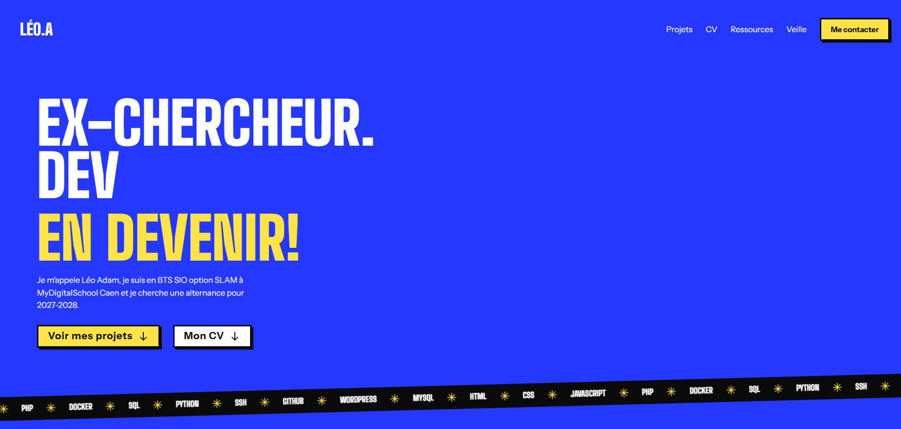

# Portfolio — Léo Adam

Portfolio réalisé dans le cadre de mon **BTS SIO option SLAM** à MyDigitalSchool Caen (promotion 2025-2027).

🔗 **Site en ligne :** https://duckzla.github.io/portfolio/



---

## Contexte du projet

J'ai choisi de le coder moi-même. L'objectif était double :

- présenter mon parcours, mes projets et mes stages à un jury et à des recruteurs.
- mettre en pratique les bases du développement web (HTML, CSS, JavaScript), du versionnement avec Git et du déploiement en ligne.

## Objectifs

- Présenter mon profil : reconversion de la recherche préclinique vers le développement web.
- Mettre en avant mes projets en premier, pour qu'un recruteur les trouve rapidement.
- Centraliser les documents de l'épreuve E5 : tableau de synthèse, modes opératoires, comptes rendus de stage.
- Publier le site gratuitement et le mettre à jour simplement à chaque `git push`.

## Contenu du site

| Page | Contenu |
|---|---|
| **Accueil** | Présentation, compétences, dernier projet, dernières expériences |
| **Projets** | Projets réalisés pendant le BTS (développement et infrastructure) |
| **CV** | Parcours, compétences, expériences et formations, CV en PDF |
| **Ressources** | Tableau de synthèse U5, modes opératoires, protocoles de stage |
| **Veille** | Veille technologique (actualité tech, outils du développeur, focus VS Code) |
| **Contact** | Coordonnées et liens (pas de formulaire, volontairement) |

Des pages article détaillent chaque projet et chaque stage (`pages/articles/`).

## Technologies utilisées

- **HTML5** : structure des pages, balises sémantiques (`header`, `main`, `footer`, `nav`)
- **CSS3** : mise en page responsive, variables CSS, sans framework
- **JavaScript** : menu burger pour la navigation mobile
- **Git / GitHub** : versionnement du code
- **GitHub Pages** : hébergement et mise en ligne
- **VS Code** : environnement de développement

Aucun framework ni bibliothèque externe : tout est écrit à la main.

## Architecture du projet

```text
portfolio/
├── index.html              # Page d'accueil
├── pages/
│   ├── projets.html
│   ├── cv.html
│   ├── ressources.html
│   ├── veille.html
│   ├── contact.html
│   └── articles/           # Détail des projets et des stages
├── assets/
│   ├── css/                # Feuilles de style découpées par rôle
│   ├── js/main.js          # Menu mobile
│   ├── fonts/              # Polices hébergées en local
│   ├── icons/              # Icônes SVG
│   ├── img/                # Images et captures
│   └── docs/               # PDF : CV, modes opératoires, tableau E5
└── readme.md
```

### Organisation du CSS

Le CSS est découpé en 5 fichiers, chargés dans cet ordre :

1. `variables.css` : couleurs, polices, ombres (une seule source pour toute la charte)
2. `base.css` : réglages de base et typographie
3. `layout.css` : header, footer, grilles
4. `components.css` : éléments réutilisables (boutons, cartes, badges…)
5. `pages.css` : styles propres à chaque page

Ce découpage permet de retrouver rapidement un style et de modifier la charte graphique à un seul endroit.

## Choix techniques

- **Sans framework :** pour maîtriser les bases avant d'utiliser des outils comme Vue.js ou Nuxt.
- **Direction artistique néo-brutaliste** : un style marqué pour se démarquer des portfolios classiques. La direction artistique a été réalisée avec l'aide de l'IA, le code est écrit à la main.
- **Polices hébergées en local (`.woff2`)** : pas d'appel à un service externe, chargement plus rapide.
- **Chemins relatifs :** le site fonctionne à la fois en local et dans le sous-dossier `/portfolio/` de GitHub Pages.
- **Responsive :** affichage adapté aux ordinateurs, tablettes et mobiles.

## Lancer le projet en local

```bash
git clone git@github.com:duckzla/portfolio.git
cd portfolio
```

Puis ouvrir `index.html` dans un navigateur, ou utiliser l'extension **Live Server** de VS Code pour recharger la page automatiquement.

## Déploiement

Le site est hébergé sur **GitHub Pages**, à partir de la branche `main` (dossier racine).
Chaque `git push` sur `main` met le site en ligne automatiquement en 1 à 2 minutes.

## Compétences BTS SIO mobilisées

| Compétence (bloc 1) | Mise en œuvre dans le projet |
|---|---|
| Développer la présence en ligne de l'organisation | Conception, développement et publication d'un site web |
| Travailler en mode projet | Planification des pages, découpage du travail, suivi avec Git |
| Mettre à disposition des utilisateurs un service informatique | Déploiement sur GitHub Pages, tests sur plusieurs écrans |
| Organiser son développement professionnel | Mise en valeur du parcours, veille technologique, centralisation des documents E5 |


## Auteur

**Léo Adam** — BTS SIO option SLAM, MyDigitalSchool Caen

- GitHub : [duckzla](https://github.com/duckzla)
- LinkedIn : [linkedin.com/in/léo-adam](https://www.linkedin.com/in/l%C3%A9o-adam)
- En recherche d'alternance en développement web pour 2027-2028
